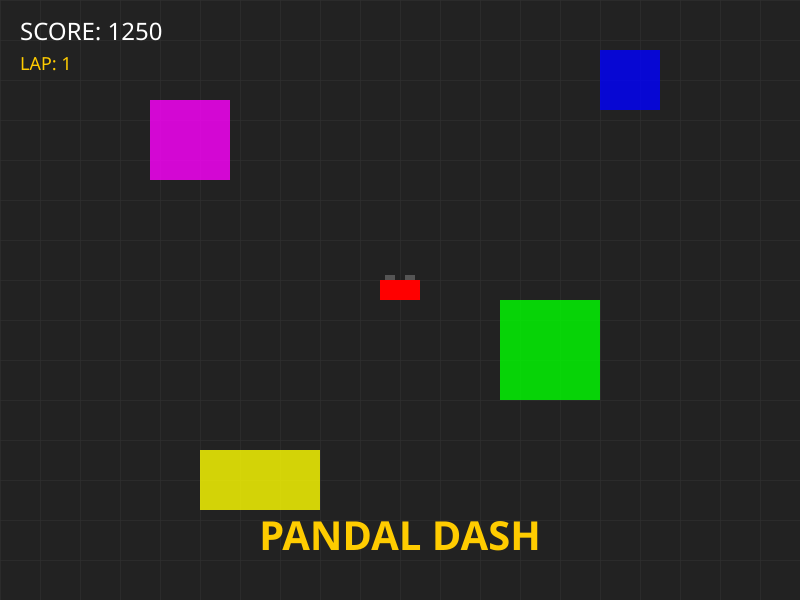

# 🏁 Pandal Dash: The Puja Race

A high-speed 2D arcade racing game set in the vibrant streets of Kolkata during the Durga Puja festival! 

Navigate through festive streets, dodge obstacles, and collect Power-ups to reach the winning Pandal!

## 🎨 Theme
**Kolkata Durga Puja Style** - Experience the lights, the sounds of the *Dhak*, and the festive spirit of Kolkata while racing in high-speed vehicles like the iconic "Toto" and "Ambassador"!

## 🛠️ Tech Stack
- **Engine:** [Phaser 3](https://phaser.io/)
- **Language:** [TypeScript](https://www.typescriptlang.org/)
- **Build Tool:** [Vite](https://vitejs.dev/)
- **Physics:** [Matter.js](https://brm.io/matter-js/)
- **Audio:** [Howler.js](https://howlerjs.com/)

## 🕹️ How to Play
- **Move:** Arrow Keys (Left/Right/Up/Down)
- **Drift:** Hold `Spacebar` while turning for high-speed cornering.
- **Goal:** Reach the finish line without crashing into walls or obstacles!

## 🚀 Installation & Local Development

1. **Clone the repository:**
   ```bash
   git clone <your-repo-url>
   cd pandal-dash
   ```

2. **Install dependencies:**
   ```bash
   npm install
   ```

3. **Start the development server:**
   ```bash
   npm run dev
   ```

4. **Build for production:**
   ```bash
   npm run build
   ```

## 📸 Visual Preview



*A stylized preview of the high-speed racing through the festive streets of Kolkata.*

## 📝 License
MIT
